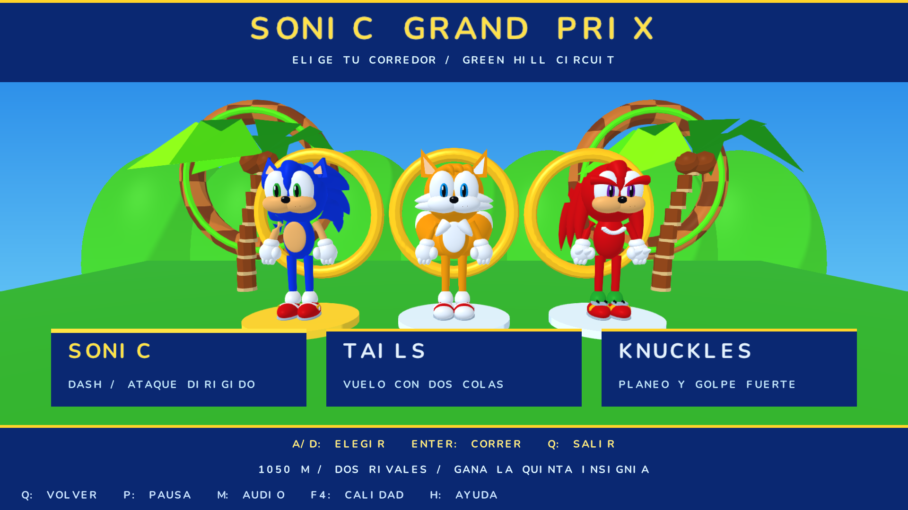

# INSERT COIN: GALAXY — versión 0.8

**Proyecto individual: Daniel Sandoval.** Repositorio: [K41S3RTK1/proyecto-final-insert-coin-galaxy](https://github.com/K41S3RTK1/proyecto-final-insert-coin-galaxy).

**Para evaluar la consigna de Software Renderer:** abre `Evaluar-CPU.command` o ejecuta `cargo run --release --locked -- --software --quality fast`. Esta ruta transforma, recorta, rasteriza y sombrea en CPU; raylib presenta el framebuffer. `Jugar.command` conserva la edición GPU HD para jugar. El modo GPU es una ampliación y **no sustituye el requisito de renderizado por software** del PDF.

- [Video académico CPU: vuelo, acercamiento, vuelta completa y alejamiento sin cortes (30 s)](output/Proyecto_Final_CPU.mp4).
- [Video HD del sistema y cuatro minijuegos (2:16)](output/Proyecto_Final_Green_Hill_Galaxy.mp4).
- [Sonic Grand Prix en HD (40 s)](output/Sonic_Grand_Prix.mp4).
- [Revisión de requisitos y puntos solicitados](RUBRICA.md) · [Integrante y contribuciones](ENTREGA.md).



Proyecto de gráficos por computadora en Rust: pilota un carguero original de disco, explora cinco planetas y cruza sus portales para jugar desafíos diferentes. **The Inkwell Garden** es un jardín de caricatura antigua inspirado en Cuphead; **Neon Dojo** es un patio urbano de lucha inspirado en Street Fighter, con personajes originales. **Banana Rush** es una carrera de tres carriles inspirada en Subway Surfers y Minion Rush, con skin de minion modelada en 3D. **Mushroom Kingdom** recrea en 2.5D el estilo de Super Mario Bros y un recorrido inspirado en el mundo 1-1, con Mario modelado mediante geometría propia. **Sonic Grand Prix** añade carreras con Sonic, Tails y Knuckles seleccionables, modelos OBJ animados, anillos y un loop de 360°. Cada minijuego sucede dentro de su propio mundo. Consulta `RACE.md` para entrar al quinto mundo y sus controles.

## Green Hill Edition

La versión 0.7 unifica el sistema solar y los cuatro escenarios con una dirección visual inspirada en Green Hill: cielo azul, agua turquesa animada, césped brillante, acantilados ajedrezados, palmeras, loops y aros dorados. La nave conserva su malla de carguero, con pintura azul/blanca y propulsión dorada. La versión 0.8 conserva esos cuatro minijuegos y añade Sonic Grand Prix como quinto mundo.

Los planetas, la nave y los nuevos accesorios siguen siendo modelos `.obj` con `.mtl` y normales `vn`. Las palmeras y loops interiores también se cargan desde OBJ. Los colores de agua/terreno se calculan en shaders propios, con iluminación de caricatura; no se descargaron texturas del juego de referencia.

El recorrido HD adicional se genera con `./tools/record-delivery.sh` (requiere FFmpeg/ffprobe). En v0.8 exporta 176 segundos en MP4 H.264, 1920×1080 a 30 fps, con audio AAC, efectos sincronizados y una melodía original. Ruta: `output/Proyecto_Final_Green_Hill_Galaxy.mp4`. El archivo ya entregado de v0.7 dura 136 segundos; la ampliación del quinto mundo se entrega también como clip separado `output/Sonic_Grand_Prix.mp4`. Ver `VIDEO.md` para el contenido y las limitaciones de esta demostración automática.

## Ejecutar

Abre `Jugar.command` desde Finder. Compila y abre `target/Insert Coin Galaxy.app`, incluyendo modelos, audio y tipografía. Si quedó abierta una versión anterior, ciérrala antes de abrir la nueva. También puedes ejecutar desde esta carpeta:

```sh
cargo run --release --locked --offline
```

En esta Mac las dependencias están disponibles. En otra computadora se necesita Rust/Cargo, CMake y compilador C; en macOS, las herramientas de línea de comandos de Xcode. Omite `--offline` para descargar dependencias la primera vez. Usa siempre `--release` para jugar.

La ventana empieza en 1280×720 y conserva la proporción al redimensionar. El renderizado principal usa **GPU a 1920×1080**, iluminación por fragmento, suavizado de bordes y tipografía Nunito de alta resolución. Calidad alta: **2560×1440**; rápida: **1280×720**. F4 o cruceta abajo alterna las tres. El modo educativo `--software` conserva el rasterizador CPU con 800×450, 960×540 y 640×360 respectivamente. El modo GPU se adopta para la experimentación y calidad visual solicitadas; no se presenta como un pipeline exclusivamente CPU.

## Modelos de la versión 0.8

Los cinco planetas exteriores ahora se cargan desde `assets/models/*.obj/.mtl`, con versiones de detalle alto y bajo. La nave se remodeló y el cargador interpreta normales `vn` para suavizar superficies curvas. Se conservan las aristas de las piezas rígidas, y los edificios y monumentos giran unidos al planeta. Consulta `MODELOS.md` para el catálogo, las convenciones de materiales y los generadores reproducibles. Funciona en GPU y en `--software`.

## Recorrido

1. Enter / X: despegar. La nave comienza cerca del portal del jardín.
2. N / R3: elegir destino. El minimapa, la distancia a la puerta y el indicador de dirección te ayudan a encontrarlo; seleccionar no teletransporta la nave.
3. A menos de 6 unidades del portal, E / X activa INSERT COIN. La nave se acerca durante 1.4 segundos; dentro hay una cuenta atrás de 3.4 segundos antes de empezar.
4. Gana el desafío para guardar su insignia y tu mejor tiempo. E / X vuelve al vuelo después de ganar o reintenta después de perder. Q / círculo vuelve al vuelo.

**Sonic Grand Prix:** elige Sonic, Tails o Knuckles y compite contra los otros dos en 1050 metros. Avance automático, dirección libre lateral, saltos, boost y Spin Dash. Sonic tiene dash con ataque dirigido a robots cercanos, Tails vuela con sus dos colas y Knuckles planea y rompe obstáculos. Anillos protegen de golpes y recargan energía; hay tres vidas y checkpoints. Ganar en primer lugar otorga la quinta insignia y guarda el récord. Ver `RACE.md`.

**Jardín:** tres vidas, 75 segundos y un jefe de 32 puntos de vida. Muévete y dispara. El jefe anuncia tres patrones: abanico dirigido, anillo radial y lluvia con un carril libre. Al llegar a media vida cambia de color, limpia los proyectiles enemigos y comienza una segunda fase más intensa. El contador solo corre después de la introducción.

**Dojo:** cinco puntos de vida, rival con seis y 90 segundos. Lee el aviso y la barra del ataque: bloquea el puño; esquiva el barrido justo antes de que termine el aviso; bloquea o esquiva la energía. Después de defender, golpea durante la recuperación del rival. Acércate si estás lejos. Mantener ataque sin defender no permite ganar. El rival acelera sus avisos a media vida.

**Banana Rush:** carrera automática con tres carriles, velocidad creciente, tres vidas, barreras que se saltan, arcos bajo los que te deslizas y trenes que debes rodear. Las bananas marcan el carril libre. Cada fila conserva al menos un carril abierto y los elementos se reciclan para que la memoria permanezca acotada. Al alcanzar **900 metros y 20 bananas** ganas la tercera insignia. Desde esa pantalla, **J / R2 / cuadrado** continúa en modo infinito; E/X vuelve al vuelo. Puntuación = metros recorridos + 25 por banana. El mejor puntaje se guarda al ganar, perder, regresar al vuelo o cerrar normalmente durante una carrera. Si sales a mitad, conservas puntaje pero no obtienes la insignia.

**Mushroom Kingdom:** avanza hacia la derecha hasta la bandera. Incluye tres vidas, 300 segundos, salto con tolerancia al borde y entrada anticipada, aceleración, carrera, tuberías sólidas, huecos, goombas y monedas. Golpea los bloques «?» desde abajo: el primero libera un champiñón; recogerlo convierte a Mario en Super Mario, que rompe ladrillos y resiste un golpe antes de perder una vida. Pisa los goombas para derrotarlos. Hay un checkpoint a mitad del recorrido. La bandera otorga la cuarta insignia y guarda el mejor tiempo. La cámara acompaña al personaje con proyección ortográfica y el fondo tiene paralaje. Es una recreación propia del estilo y mecánicas, no una reproducción exacta del juego original.

Para probarlo rápidamente: despega, pulsa **N tres veces**, **Home** para colocarte frente al portal y **E** para entrar. También puedes llegar pilotando.

## Vibración del DualSense

En macOS 11 o posterior se usa **GameController + Core Haptics** mediante un puente Objective-C compilado con el proyecto. La llamada de vibración de raylib/GLFW es un stub en la versión instalada, por eso se usa la API nativa. La detección consulta las localidades del mando y crea un motor para sus actuadores, conforme a la [documentación de Apple](https://developer.apple.com/documentation/gamecontroller/gcdevicehaptics).

Hay pulsos diferentes para disparos, impactos, daño, bloqueo, salto, bananas, portal, cambio de fase y victoria/derrota. Se priorizan los eventos importantes y los pulsos duran como máximo 0.55 segundos. Se detienen al pausar, perder foco, desconectar, desactivar la vibración o cerrar. El interruptor es independiente del audio.

**F5 / cruceta arriba** activa o desactiva. En los mundos con cabecera general se indica `VIB ON`, `VIB OFF` o `VIB N/D`; F1 muestra el número de pulsos aceptados por la API. Con un solo mando conectado se puede asociar sin ambigüedad al jugador. Con varios mandos, el puente no activa vibración para evitar enviar pulsos a otro dispositivo. En otras plataformas el juego sigue funcionando y muestra N/D: este backend háptico es específico de macOS. No se implementan gatillos adaptativos.

La aplicación detectó soporte háptico del mando conectado en esta Mac y el diagnóstico registró cinco pulsos aceptados por Core Haptics durante la prueba de portal, salto, deslizamiento y recolección. La intensidad y sensación final deben comprobarse sosteniendo el mando; no puede verificarse físicamente desde una captura.

## Controles

Teclado y mando funcionan simultáneamente; los avisos cambian según el último dispositivo utilizado. El usuario ya confirmó el funcionamiento de teclado y DualSense en la versión anterior. Esta versión conserva esa base y reutiliza los botones del runner para Mario; la sensación de los controles y la intensidad requieren una prueba física del usuario.

| Acción | Teclado | DualSense / mapeo estándar |
|---|---|---|
| Volar / moverse en jardín | WASD | Stick izquierdo |
| Mirar en vuelo | Flechas | Stick derecho |
| Subir / bajar en vuelo | R / F | R1 / L1 |
| Frenar / bloquear en dojo | Ctrl izquierdo o K | L2 |
| Turbo en vuelo | Shift izquierdo mantenido | L3 mantenido |
| Moverse en dojo | A / D | Stick izquierdo horizontal |
| Disparar / golpear | Espacio o J | R2 / cuadrado |
| Esquivar en dojo | L o pulsar Shift izquierdo | Pulsar R1 |
| Cambiar carril en Banana Rush | A/D o flechas izquierda/derecha | Stick izquierdo horizontal |
| Saltar en Banana Rush | Espacio / W / flecha arriba | X |
| Mover a Mario | A/D o flechas izquierda/derecha | Stick izquierdo |
| Saltar con Mario | Espacio / W / flecha arriba | X |
| Correr con Mario | Shift o J mantenido | R2 / cuadrado mantenido |
| Deslizarse en Banana Rush | S / flecha abajo | L2 |
| Continuar en infinito tras la meta | J | R2 / cuadrado |
| Dirigir / elegir corredor | A / D | Stick izquierdo |
| Saltar en Sonic GP | Espacio | X |
| Boost en Sonic GP | Shift mantenido | R2 mantenido |
| Cargar y soltar Spin Dash | K / Ctrl izquierdo | L2 |
| Habilidad del corredor | L | R1 |
| Vibración on/off | F5 | Cruceta arriba |
| Elegir planeta durante vuelo | N | Pulsar R3 |
| Entrar / confirmar / reintentar | E / Enter | X |
| Volver al vuelo / cancelar portal | Q | Círculo |
| Asistencia orbital | Tab | Triángulo |
| Pausa | P / Escape | Options |
| Silenciar / activar sonidos | M | Share / Create |
| Cambiar calidad | F4 | Cruceta abajo |
| Ver ayuda | H | — |
| Recuperar nave frente al destino | Home | — |
| Métricas | F1 | — |
| Activar/desactivar frustum culling | F2 | — |
| Activar/desactivar LOD | F3 | — |
| Captura en `output/captura.png` | F12 | — |
| Cerrar | F10 / cerrar ventana | — |

Asistencia orbital: se activa dentro de 26 unidades del planeta seleccionado. A/D rodean el planeta, W/S cambian radio y R/F cambian altura. La cámara apunta al planeta solamente en este modo explícito. En vuelo libre sigue la nave; en los interiores se traslada suavemente sin girar sola.

Sticks con zona muerta 0.18 y reescalado. Perder foco o desconectar el mando pausa la partida; P/Options reanuda. H también pausa: cierra la ayuda y reanuda. El mando debe estar conectado por USB o Bluetooth y reconocido por el sistema como gamepad estándar. Vibración nativa en macOS; no se implementan gatillos adaptativos.

## Progreso y audio

Las insignias y mejores tiempos se guardan automáticamente al ganar en `saves/progress.txt` dentro del proyecto. El formato v4 conserva medallas, tiempos y récord de Banana Rush de archivos v1/v2/v3 e incorpora la quinta medalla y el mejor tiempo de Sonic Grand Prix; la escritura usa archivo temporal y reemplazo atómico. Si el archivo no se puede leer o es inválido, se informa el problema y se conserva el original. Si no se puede escribir, la victoria queda en memoria y aparece un aviso. `--save ruta` permite usar otro archivo, útil para pruebas. Las capturas y benchmarks no cargan ni modifican partidas.

Se incluyen quince efectos WAV originales sintetizados por `tools/build_audio.py`: disparo, impacto, daño, victoria, derrota, portal, cuenta atrás, aviso, segunda fase, bloqueo, esquiva, golpe, motor, salto y banana. El tono y volumen del motor responden a la velocidad. Si el dispositivo de audio no está disponible se puede seguir jugando sin sonido. No hay música de terceros.

## Implementación y explicación

- CPU: simulación, colisiones, generación de mallas, matrices modelo/vista/proyección, culling y selección de LOD.
- GPU: rasterización de los vértices transformados, profundidad, normales interpoladas, iluminación por fragmento, materiales GLSL y antialiasing de pantalla. Render targets separados para escena y resultado suavizado. F12 exporta ese resultado a resolución interna.
- Modo alternativo `--software`: clipping homogéneo, rasterización baricéntrica, z-buffer y shaders CPU propios. `--render` y `--benchmark` usan este modo sin ventana; `--gpu-render` abre un contexto OpenGL y captura la ruta HD.
- Cinco planetas orbitan y rotan con delta de simulación. El acercamiento exterior es continuo; entrar al minijuego es una transición opcional a coordenadas interiores.
- Simulación fija de 120 pasos/s. Se limita el tiempo acumulado tras pausas largas a 0.25 s por cuadro. La pausa congela simulación y reutiliza la imagen para reducir consumo.
- Nave OBJ/MTL original de 9,720 triángulos, inspirada en el Halcón del proyecto previo; generador reproducible en `tools/build_ship.py`.
- Esferas y portales procedurales, cubos y cilindros orientados para escenario y personajes. Decoración radial sobre planetas, colisiones nave/esfera y proyectiles con prueba de segmento.
- Frustum culling por esfera; LOD por distancia para planetas OBJ y tamaño proyectado para esferas procedurales. F1 muestra resolución y estadísticas; F2/F3 permiten comparar en una cámara pausada.
- Decoración con semilla fija 2026. Esto NO implementa todavía un algoritmo de ruido de clase para distribución; no se reclama ese criterio.

| Archivo | Responsabilidad |
|---|---|
| `src/math.rs`, `src/obj.rs` | Vectores, matrices y cargador OBJ/MTL |
| `src/renderer.rs` | Geometría compartida, captura de vértices GPU y rasterizador CPU |
| `src/gpu.rs`, `shaders/` | Renderizado HD, materiales GLSL, fuentes y antialiasing |
| `src/platformer.rs`, `src/platform_scene.rs` | Física de Mario, nivel lateral, personaje y escenario |
| `src/scene.rs`, `src/world.rs` | Sistema solar, nave, jardín y jefe |
| `src/dojo_scene.rs` | Patio urbano, luchadores y animación |
| `src/game.rs`, `src/duel.rs` | Estados, vuelo, portales y reglas de combate |
| `src/runner.rs`, `src/runner_scene.rs` | Carrera, generación de obstáculos, trenes, bananas y minion |
| `src/race.rs`, `src/race_scene.rs` | Carrera, tres héroes OBJ articulados, habilidades, loop y selector |
| `src/haptics.rs`, `platform/macos/haptics.m`, `build.rs` | Pulsos y conexión nativa a GameController/Core Haptics |
| `src/input.rs`, `src/ui.rs` | Acciones comunes, mando, tipografía y HUD |
| `src/audio.rs`, `src/feedback.rs` | Sonidos y eventos de juego |
| `src/progress.rs` | Insignias, récords y persistencia |
| `src/main.rs` | Ventana, bucle fijo, calidad y presentación |

## Verificación

```sh
cargo test --locked --offline
cargo clippy --locked --offline --all-targets -- -D warnings
cargo run --release --locked --offline -- --gpu-render output/jardin.png --scene garden-phase2
cargo run --release --locked --offline -- --gpu-render output/dojo.png --scene dojo
cargo run --release --locked --offline -- --gpu-render output/mario.png --scene mario
cargo run --release --locked --offline -- --frames 180 --scene mario
```

Escenas nuevas: `race`, `race-start`, `race-loop`, `race-tails`, `race-knuckles`, `race-planet`, `sonic-model`, `tails-model`, `knuckles-model`.

Escenas anteriores: `garden-model`, `dojo-model`, `runner-model`, `mario-model`, `mario`, `mario-mid`, `mario-end`, `mario-planet`, `runner`, `runner-jump`, `runner-slide`, `runner-planet`, `minion`, `title`, `flight`, `battle`, `garden-phase2`, `dojo`, `dojo-counter`, `dojo-planet`, `portal`, `system`, `victory`, `close`, `orbit`, `ship`. Calidad opcional: `--quality balanced|high|fast`. Las capturas usan el renderizador real; indican SIN AUDIO porque no abren un dispositivo. `--frames N` termina una prueba de ventana tras N cuadros.

Validación de entrega v0.8 (2026-11-05): **48 pruebas**. Incluyen un vuelo académico continuo con acercamiento, más de una vuelta completa y alejamiento, sin teleportación ni cambio de escena. La grabación `--software --record` usa exclusivamente el renderer CPU, sin abrir contexto GPU.

Validación inicial de versión 0.8: **47 pruebas**. La carrera se completa mediante entradas reales con los tres personajes; se verifican selección, carga de Spin Dash, habilidades, continuidad del loop, daño, checkpoint, pausa, quinta insignia y migración v3→v4. Clippy pasa sin advertencias. Capturas verificadas en GPU y CPU.

Prueba corta de v0.8: `--frames 120 --scene race-start`, 1920×1080: **54.1 FPS**, p95 **23.1 ms**, límite de ventana 60 FPS. Muestra de esta escena, no garantía de rendimiento de toda la partida.

Validación histórica de versión 0.7: **40 pruebas**. Incluyen carga de todos los OBJ/MTL, índices de normales, niveles de detalle y rasterización CPU de los cuatro modelos nuevos. Incluyen una partida completa de Mario mediante movimiento y salto reales hasta ganar la cuarta insignia; bloques, champiñón, crecimiento, ladrillos, pisotones, daño, checkpoint, salto anticipado y migración de guardados v2→v3. También se conservan las pruebas de los tres mundos anteriores. Ejecutar Clippy con advertencias tratadas como errores.

Prueba corta de v0.7 en la escena cercana al jardín (`--frames 120 --scene close`) a 1920×1080: **54.0 FPS**, p95 **24.9 ms**. La mezcla del audio del video estaba en segundo plano; es una muestra de esa carga concreta, no una garantía de toda la partida. El video exportado tiene 30 fps constantes por su paso de simulación fijo.

Medición histórica de v0.5 (antes de los nuevos OBJ) en Apple M1, resolución interna 1920×1080 y ventana Retina (límite 60 FPS), 120 cuadros por escena: Mario **55.2 FPS**, Banana Rush **56.7 FPS**, jardín **57.1 FPS**, dojo **56.5 FPS**; p95 entre **17.7 y 17.9 ms**. Son muestras cortas en posiciones concretas, no una garantía de toda la partida.

Se verificó en la aplicación macOS el portal al cuarto mundo, movimiento lateral, salto que activa el primer bloque «?», pausa, cambio a 2560×1440 y captura F12. La partida existente mostró sus tres insignias conservadas.

Las capturas HD se generan con el renderer real en `output/`. El reconocimiento del mando y la aceptación de pulsos nativos se comprobaron en v0.4; eso no equivale a comprobar físicamente la sensación del mando. Usa F1 para métricas y F4 para cambiar calidad.

## Entrega académica

Consulta `RUBRICA.md` para evidencia y pendientes, y `DEMO.md` para el recorrido de demostración. El video se genera con el recorrido documentado en `VIDEO.md`; los datos del trabajo individual y la asistencia están en `ENTREGA.md`; la revisión del docente determina cuáles criterios opcionales acepta. No se promete una calificación.

Concepto de mundos arcade propuesto por el estudiante. Código, modelos y sonidos asistidos por Codex; cargador OBJ y operaciones vectoriales reutilizan trabajo del Lab 4 del estudiante. No se incluyen modelos, música o sprites descargados de videojuegos. Cuphead, Street Fighter, Subway Surfers, Minion Rush y Super Mario Bros son referencias artísticas. Sonic / Green Hill es la referencia visual solicitada desde la versión 0.7. En v0.8, Sonic, Tails y Knuckles son recreaciones propias con mallas y materiales OBJ/MTL, basadas en las referencias del estudiante; no son los modelos oficiales ni archivos extraídos de juegos. Mario y el nivel son recreaciones con geometría/código propios, sin sprites ni música extraídos del juego. La tipografía Nunito está incluida bajo SIL Open Font License; ver `assets/fonts/OFL.txt`. Se instancia el peso 700 del archivo variable para rasterizarlo correctamente con stb_truetype. La skin de minion es una recreación mediante geometría propia solicitada por el estudiante; no es un personaje original ni una afiliación con los titulares de Minions. Dependencias exactas en Cargo.lock; API contrastada con el código local de raylib 6.0.0.
