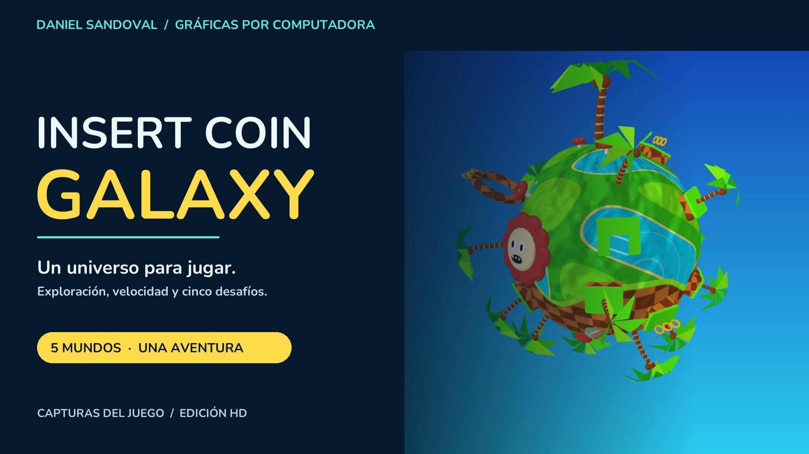
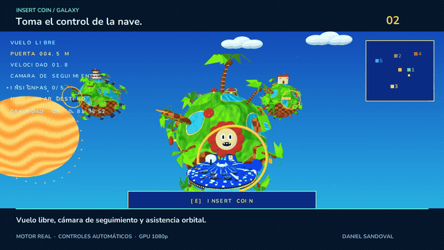
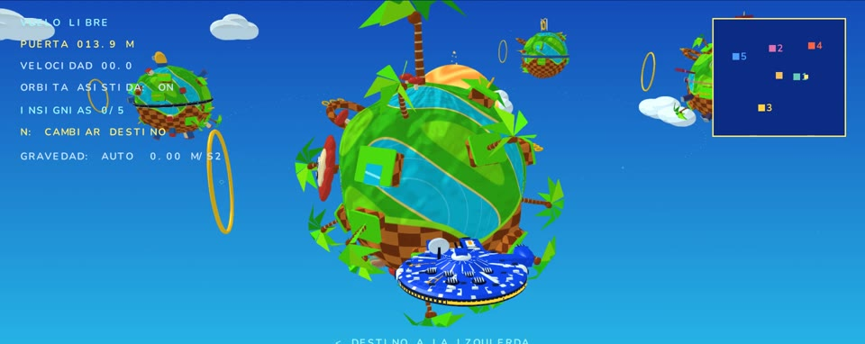
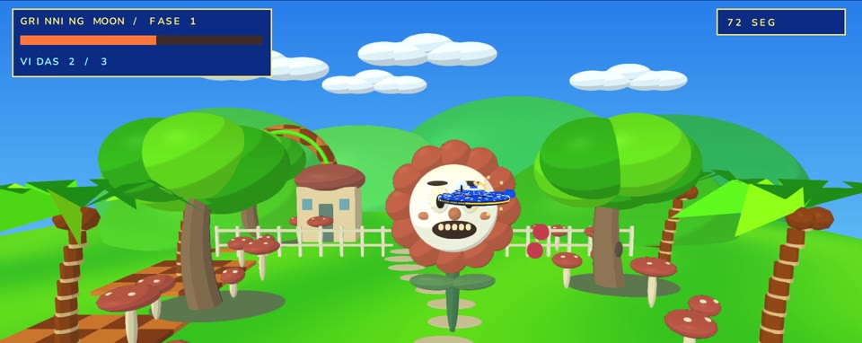
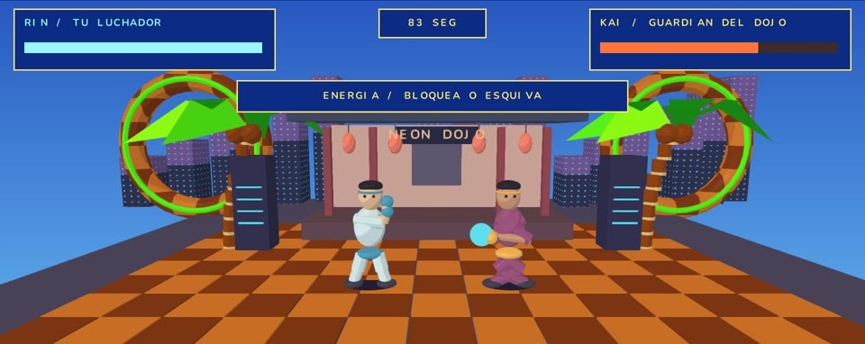
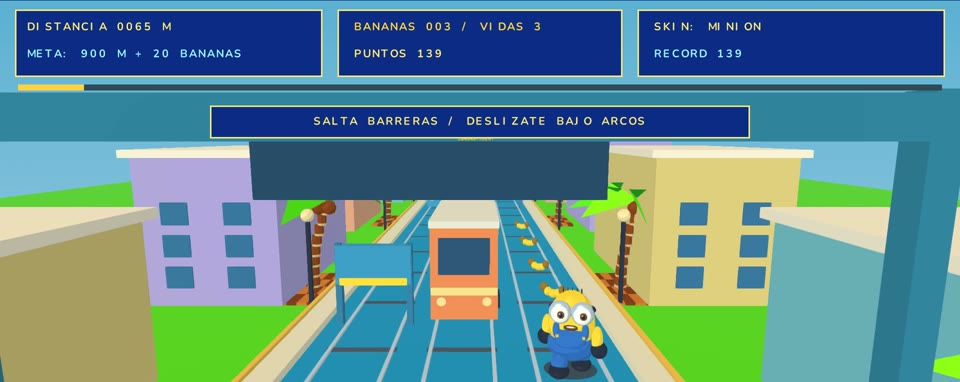
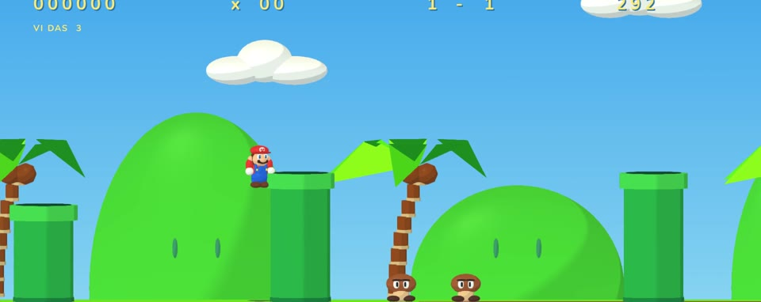
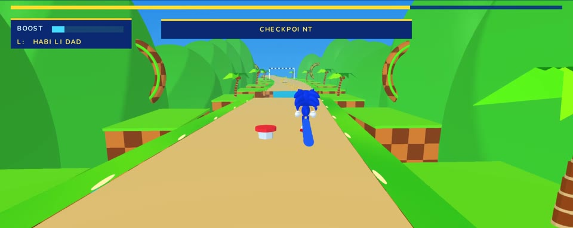
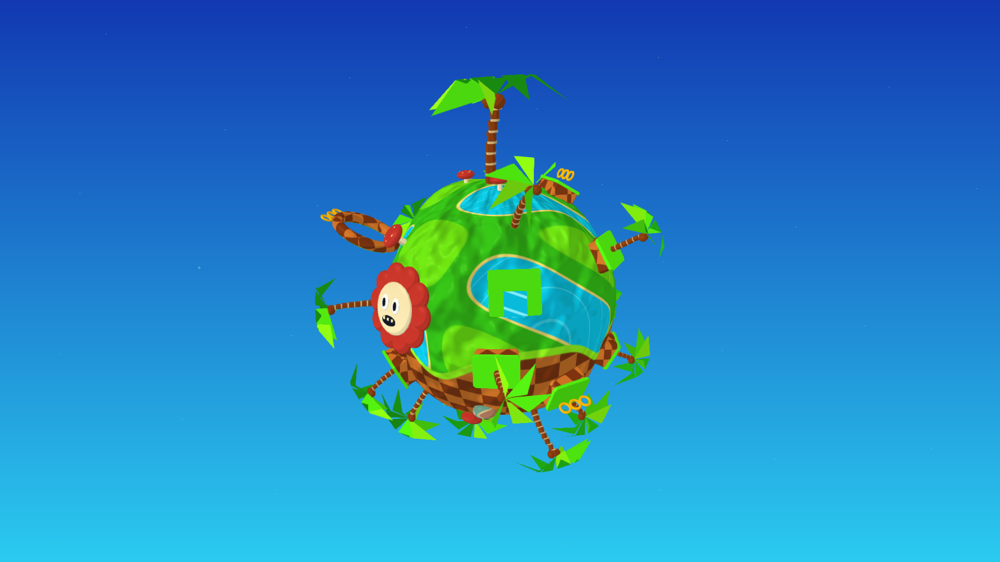

<div align="center">



**Explora una galaxia arcade. Aterriza. Cambia de juego.**

Proyecto individual de **Daniel Sandoval** · Gráficas por Computadora

**Rust** &nbsp; / &nbsp; **5 mundos** &nbsp; / &nbsp; **OBJ + MTL** &nbsp; / &nbsp; **CPU + GPU** &nbsp; / &nbsp; **DualSense**

[▶ Ver presentación HD](https://github.com/K41S3RTK1/proyecto-final-insert-coin-galaxy/raw/refs/heads/main/output/Presentacion_Galaxy.mp4) &nbsp; · &nbsp; [Empezar a jugar](#empezar-a-jugar) &nbsp; · &nbsp; [Entrega académica](#entrega-académica)

</div>

## Una nave. Cinco formas de jugar.

Pilota un carguero entre planetas que orbitan y giran en tiempo real. Acércate a un portal, pulsa **INSERT COIN** y entra a un desafío distinto: combate, carreras, plataformas o velocidad. Gana insignias y conserva tus mejores marcas.

<p align="center">
  <a href="https://github.com/K41S3RTK1/proyecto-final-insert-coin-galaxy/raw/refs/heads/main/output/Presentacion_Galaxy.mp4">
    
  </a>
  <br>
  <sub>Vista del motor real · La presentación utiliza controles automáticos.</sub>
</p>

## Elige tu próximo destino

<table>
<tr>
<td width="50%">

<b>00 / La galaxia</b><br>
Vuelo libre, portales y una cámara que acompaña a la nave.
</td>
<td width="50%">

<b>01 / The Inkwell Garden</b><br>
Disparos, patrones y un jefe con segunda fase.
</td>
</tr>
<tr>
<td>

<b>02 / Neon Dojo</b><br>
Bloquea, esquiva y aprovecha el momento del contraataque.
</td>
<td>

<b>03 / Banana Rush</b><br>
Tres carriles, trenes, saltos y bananas. Continúa en modo infinito.
</td>
</tr>
<tr>
<td>

<b>04 / Mushroom Kingdom</b><br>
Plataformas laterales, bloques, champiñones y checkpoints.
</td>
<td>

<b>05 / Sonic Grand Prix</b><br>
Sonic, Tails y Knuckles: anillos, Spin Dash, rivales y un loop de 360°.
</td>
</tr>
</table>

## Empezar a jugar

En macOS, abre **[Jugar.command](Jugar.command)**. Compila el proyecto y abre la aplicación con todos sus recursos. Cierra una versión anterior si todavía está abierta.

```sh
git clone https://github.com/K41S3RTK1/proyecto-final-insert-coin-galaxy.git
cd proyecto-final-insert-coin-galaxy
cargo run --release --locked
```

Requisitos: **Rust/Cargo, CMake y un compilador C**. En macOS, instala Xcode Command Line Tools. La primera compilación descarga las dependencias; después puedes añadir `--offline`.

| Para… | Abre | Renderizado |
|---|---|---|
| **Jugar en HD** | `Jugar.command` | GPU · 1080p por defecto, hasta 1440p |
| **Demostrar el pipeline propio** | `Evaluar-CPU.command` | Rasterización por software · CPU |

**Primer viaje:** Enter / X para despegar → N / R3 elige destino → acércate al portal → E / X para entrar. **H** abre la ayuda.

## Teclado o DualSense

| Acción | Teclado | PS5 |
|---|---|---|
| Mover / orientar la nave | WASD / flechas | Stick izquierdo / derecho |
| Entrar / volver | E o Enter / Q | X / círculo |
| Elegir destino / asistencia orbital | N / Tab | R3 / triángulo |
| Disparar / golpear | Espacio o J | R2 / cuadrado |
| Saltar / habilidad en Sonic GP | Espacio / L | X / R1 |
| Frenar / cargar Spin Dash | Ctrl o K | L2 |
| Pausar | P o Escape | Options |
| Calidad / vibración | F4 / F5 | Cruceta abajo / arriba |
| Gravedad / normal mapping | G / F6 | Cruceta izquierda / derecha |

Vibración nativa en macOS mediante GameController y Core Haptics. **[Controles completos y reglas de cada mundo →](docs/GUIA.md#controles)**

## Lo que sucede detrás de la imagen

| Geometría y escena | Luz y materiales | Simulación y rendimiento |
|---|---|---|
| Modelos **OBJ + MTL** con normales | **Normal mapping** en CPU y GPU | Gravedad sobre la nave |
| Distribución **Perlin 3D** con semilla | Sol y agua animados | Colisiones y paso fijo de 120 Hz |
| Detalles orientados a superficies curvas | Iluminación por fragmento | Frustum culling y LOD por distancia |
| Cinco planetas con órbita y rotación | Z-buffer y clipping propios en CPU | Cámara de seguimiento y progreso guardado |

<details>
<summary><b>Comparar el normal mapping</b></summary>

Misma geometría y cámara; cambia la normal utilizada para iluminar cada fragmento. **F6** alterna el efecto y **F1** muestra su estado.

| Desactivado | Activado |
|---|---|
|  |  |

[Algoritmos, semilla y pruebas reproducibles →](OPCIONALES.md)

</details>

## Entrega académica

La demostración del **software renderer** se realiza con **Evaluar-CPU.command**. La edición GPU muestra la ampliación visual; el video CPU conserva el recorrido continuo exigido.

| Video | Contenido | Duración |
|---|---|---|
| **[Presentación HD](https://github.com/K41S3RTK1/proyecto-final-insert-coin-galaxy/raw/refs/heads/main/output/Presentacion_Galaxy.mp4)** | Montaje de los cinco mundos, modelos y normal mapping | **1:56** |
| **[Recorrido CPU](output/Proyecto_Final_CPU.mp4)** | Acercamiento, vuelta completa y alejamiento sin cortes | **0:30** |
| [Recorrido HD completo](output/Proyecto_Final_Green_Hill_Galaxy.mp4) | Motor real, portales y los cinco minijuegos | 2:56 |

**54 pruebas Rust + 3 Python.** Las pruebas comprueban física, progresión, modelos, rasterización y las funciones opcionales. La coincidencia de Perlin con lo visto en clase debe confirmarse con el material del curso.

```sh
cargo test --release --locked --offline
cargo clippy --locked --offline --all-targets -- -D warnings
python3 tools/test_procedural.py
```

[Revisión de rúbrica](RUBRICA.md) · [Guion de demostración](DEMO.md) · [Datos de entrega](ENTREGA.md) · [Videos y regeneración](VIDEO.md)

<details>
<summary><b>Documentación técnica y créditos</b></summary>

- [Guía completa](docs/GUIA.md): controles, reglas, arquitectura, audio, guardado e historial de verificación.
- [Modelos y generadores](MODELOS.md): OBJ/MTL, materiales y niveles de detalle.
- [Sonic Grand Prix](RACE.md): personajes, habilidades y carrera.
- [Opcionales](OPCIONALES.md): Perlin, normal mapping y gravedad.

Concepto y dirección del proyecto: **Daniel Sandoval**. El cargador OBJ y las operaciones vectoriales parten de su trabajo del Lab 4.

Cuphead, Street Fighter, Subway Surfers, Minion Rush, Mario y Sonic / Green Hill son referencias artísticas. Los personajes son recreaciones del proyecto; no son modelos oficiales ni archivos extraídos de los juegos. No se reclama propiedad de esos personajes ni afiliación con sus titulares. Música y efectos sintetizados para el proyecto. Tipografía [Nunito / SIL Open Font License](assets/fonts/OFL.txt).

</details>
