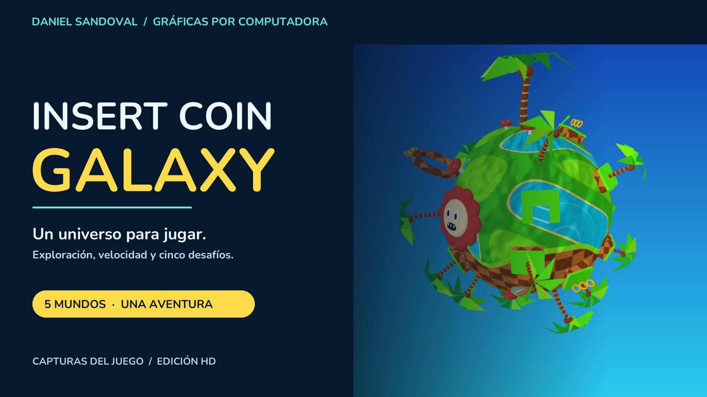

# Videos del proyecto

## Presentación final · 1:56

**[Abrir Presentacion_Galaxy.mp4](https://github.com/K41S3RTK1/proyecto-final-insert-coin-galaxy/raw/refs/heads/main/output/Presentacion_Galaxy.mp4)**



Montaje en **1920×1080, 30 fps, H.264 y AAC estéreo**, con portada, capítulos, fundidos breves, efectos sincronizados, música sintetizada para el proyecto y cierre con el nombre de Daniel Sandoval. Capturas actualizadas de v0.9. Audio normalizado con objetivo −18 LUFS y límite de pico verdadero −1.5 dBTP. No contiene narración de voz.

| Tiempo | Contenido |
|---|---|
| 00:00–00:04 | Portada del proyecto |
| 00:04–00:10 | Sistema solar de cinco mundos |
| 00:10–00:22 | Nave, vuelo y cámara de seguimiento |
| 00:22–00:30 | Modelos y detalles sobre la superficie |
| 00:30–00:39 | The Inkwell Garden |
| 00:39–00:48 | Neon Dojo |
| 00:48–00:58 | Banana Rush |
| 00:58–01:10 | Mushroom Kingdom |
| 01:10–01:13 | Selección de Sonic, Tails y Knuckles |
| 01:13–01:45 | Sonic Grand Prix: carrera, habilidades y loop |
| 01:45–01:51 | Normal mapping activado / desactivado |
| 01:51–01:56 | Créditos y acceso al repositorio |

El video muestra el **motor real en modo GPU con controles automáticos**, identificado en los rótulos. El montaje recorta y une escenas; no se presenta como una partida continua ni como una sesión física con mando. La portada y la comparación de normales usan capturas reales del renderer. No se fabrican victorias ni insignias. La grabación utiliza progreso aislado en memoria.

## Evidencia académica CPU · 0:30

**[Proyecto_Final_CPU.mp4](output/Proyecto_Final_CPU.mp4)** · 800×450 nativos · 900 cuadros · H.264 + AAC.

| Tiempo | Vuelo continuo, sin cortes |
|---|---|
| 00:00–00:02 | Vuelo y entorno inicial |
| 00:02–00:07 | Acercamiento al planeta |
| 00:07–00:20 | Asistencia orbital y más de una vuelta completa |
| 00:20–00:30 | Desactivación de asistencia y alejamiento |

Esta grabación usa el rasterizador CPU propio y no inicializa un contexto GPU. La asistencia orbital se identifica como AUTO y no se presenta como órbita física. No hay teletransporte ni cambio de escena en el tramo. Se conservan normal mapping y gravedad activados por defecto en v0.9. FFmpeg verificó la decodificación completa.

**Este es el video que acompaña la demostración del software renderer.** La presentación HD muestra la ampliación visual. Los FPS fijos de ambos archivos no son un benchmark de rendimiento interactivo.

## Recorridos adicionales

| Archivo | Duración | Contenido |
|---|---:|---|
| [Proyecto_Final_Green_Hill_Galaxy.mp4](output/Proyecto_Final_Green_Hill_Galaxy.mp4) | 2:56 | Captura HD completa actualizada: sistema, vuelo, modelos, portales y cinco minijuegos |
| [Sonic_Grand_Prix.mp4](output/Sonic_Grand_Prix.mp4) | 0:40 | Clip de v0.8 con selección y carrera de Sonic |

El recorrido completo incluye cámaras de presentación y cortes entre secciones. Su tramo de vuelo de 00:07 a 00:31 conserva entradas y cámara del juego sin reposicionar la nave. Los minijuegos utilizan sus reglas reales.

## Regenerar

Requisitos: Rust/Cargo, FFmpeg y ffprobe. Para las tarjetas tipográficas del montaje, Pillow (`python3 -m pip install Pillow`). No se necesita descargar música ni modelos.

```sh
# Captura actualizada de los cinco mundos: abre una ventana del juego.
./tools/record-delivery.sh

# Montaje final, créditos, galería y vista animada del README.
python3 tools/build_presentation.py

# Evidencia independiente del rasterizador CPU: sin ventana GPU.
./tools/record-academic.sh
```

`tools/build_presentation.py` recorta los segmentos de `output/green-hill-silent.mp4`, crea rótulos tipográficos, reubica los eventos de sonido según el montaje y llama al mezclador musical. El manifiesto exacto de capítulos se guarda en `docs/media/chapters.json`. Los archivos intermedios permanecen en `output/presentation-build/` y no se versionan.

La música es una frase original sintetizada y los efectos provienen de `assets/audio/`. No se utiliza música extraída de videojuegos. La tipografía Nunito está incluida bajo SIL Open Font License.

Para una captura breve: `target/release/arcade-galaxy --record output/prueba.mp4 --frames 60 --quality fast`. `--record-start N --frames M` exporta el intervalo de cuadros [N, M), simulando desde el comienzo. Cerrar la ventana cancela la grabación.

## Verificación de la presentación — 2026-11-11

FFprobe: 116.000 s, 3480 cuadros H.264, 1920×1080 a 30 fps, AAC estéreo. FFmpeg decodificó el archivo completo sin errores. Se revisaron fotogramas de los doce tramos; los marcadores de Mario y Sonic quedan visibles. Pico de muestras de audio medido: −2.0 dBFS. Portada, seis capturas y GIF del README proceden de estos recursos reales del juego. Enlaces locales y duraciones del manifiesto comprobados.
